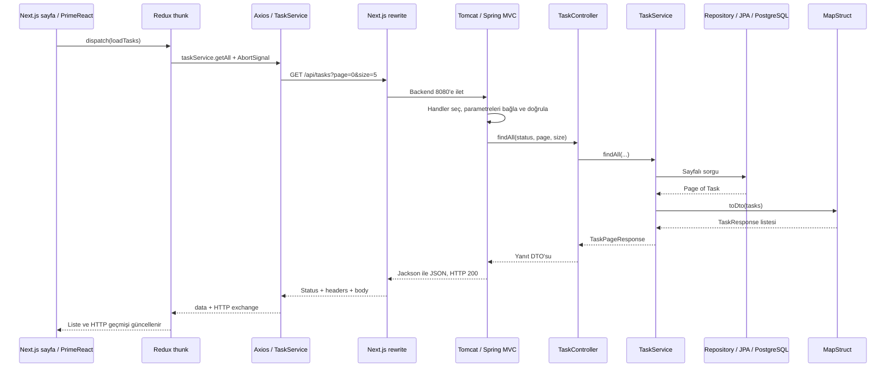

# 06 — Bir isteğin yaşam döngüsü

Bu dersi [ayrı timeline ekranında](http://localhost:5173/pages/istegin-yolculugu) adım adım anlatabilirsin. DispatcherServlet, HandlerMapping, HandlerAdapter, binding, validation ve dönüşüm ayrı duraklardır. Her durağın açıklama, kod örneği ve debugger ipucu bulunur. [Ekranın kullanım notları ve 23 durak](17-interaktif-istek-yolculugu.md).

## Çalışan akış

Aşağıdaki sıra mevcut uygulamadaki liste isteğini gösterir. Security/JWT P5, ortak request ID/logging filter P6'da eklenecek.

Next.js burada tarayıcının göreli API isteğini backend'e taşır. Redux HTTP sunucusu değildir; UI durumunu ve asenkron isteğin sonucunu yönetir. MapStruct repository'ye gitmez; Service'in aldığı modeli DTO'ya çevirir.

## Controller'dan önce neler olur?

Tomcat servlet filtre zincirini ve Spring MVC'yi çalıştırır. DispatcherServlet uygun handler'ı seçer. MVC parametre bağlama, JSON dönüşümü ve validation yapar. Bu hazırlıkta hata varsa controller metodu veya Service çağrılmaz.

## Service ve transaction sınırı

Service iş kuralını yürütür; repository JPA üzerinden veriye erişir. Okuma metotları readOnly transaction kullanır. POST/PUT/PATCH/DELETE kendi yazma transaction'ındadır.

PUT/PATCH'te yönetilen entity değişir. JPA dirty checking ve flush/commit sırasında SQL oluşur. `save` veya alan değiştirme satırı SQL'in mutlaka tam o anda çalıştığı anlamına gelmez. SQL loguyla birlikte göster.

Service MapStruct'tan DTO alır; Spring MVC/Jackson DTO'yu JSON'a yazar. Status ve header'lar controller dönüş biçimine göre belirlenir. Java nesnesi ile HTTP yanıtı aynı kavram değildir.

## Hata hangi aşamada oluşur?

| İstek | Durduğu yer | Sonuç |
| --- | --- | --- |
| status=UNKNOWN veya page=-1 | MVC parametre bağlama/doğrulama | 400 |
| Boş title POST | MVC Bean Validation | 400; Service çağrılmaz |
| Olmayan ID'ye GET | Service kaynak arama | 404 |
| DONE → OPEN PUT/PATCH | Service iş kuralı | 409; kayıt değişmez |
| Geçerli POST | Bütün akış | 201 + Location |

MVC hataları `controllers/advice/GlobalExceptionHandler` üzerinden ProblemDetail'e çevrilir. Axios hata yanıtını kaybetmeden Redux'a ve forma taşır. Ağ hatasında HTTP status yoktur; null tutulur.

## Debugger turu

1. TasksPage'de dispatch ve taskSlice'da ilgili thunk.
2. services/taskService.js ve services/api.js.
3. TaskController.findAll veya create.
4. TaskService'te repository çağrısı ve validateStatusTransition.
5. TaskMapper arayüzü ve derlenmiş TaskMapperImpl.
6. GlobalExceptionHandler'ın ilgili handler'ı.

Repository'de önce çağrı noktasını ve SQL logunu kullan. İlk anlatımda bütün framework içini adımlamak gerekmez.

## P5 ve P6 eklendiğinde

P5'te Spring Security, MVC'den önce JWT'yi doğrular ve rolü denetler. Token yok/geçersiz ise 401; USER silmek isterse 403 olur; controller'a ulaşmayabilir. Filtre hataları MVC advice'tan otomatik geçmez; Security handler'ları ortak hata biçimini üretir.

P6'da Security'den önce tek kez kayıtlı logging filter, X-Request-ID, süre ve sonuç logunu ilişkilendirir. MDC temizliği finally içinde yapılır. Bu mekanizma şu an yoktur. Mevcut HTTP geçmişindeki UUID yalnızca UI seçim kimliğidir; sunucu request ID'si değildir.

Ekrandaki şema öğretim içindir. Gösterilen toplam süre tarayıcının gözlemidir; ayrı katmanların ölçülmüş süreleri veya canlı yürütme izleri değildir.

[Önceki: HTTP metodları](05-http-metotlari.md) · [Sonraki: Spring Security](07-spring-security.md)
